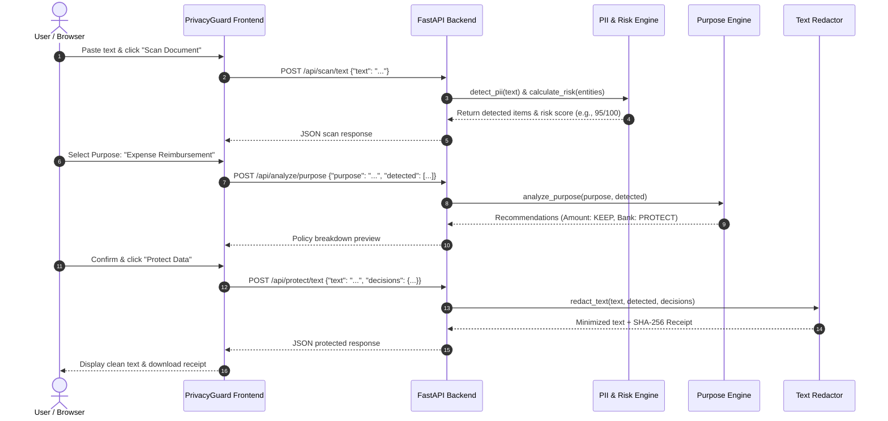
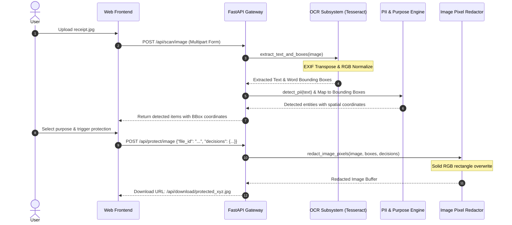

# High-Level Design (HLD)

## Project: PrivacyGuard — Purpose-Aware Personal Data Leak Prevention System
* **Document Version:** 1.0.0
* **Status:** Approved / Active
* **Date:** November 2026

---

## 1. System Overview

**PrivacyGuard** is engineered as a local-first, zero-knowledge security layer that safeguards personal information during digital document sharing. The architecture decouples document ingestion, entity recognition, contextual purpose evaluation, and permanent redaction.

### Core Architectural Principles:
1. **Local Isolation:** All computational workloads (OCR, regex entity matching, pixel redaction, PDF stream editing) execute locally on `127.0.0.1`.
2. **Context-Driven Minimization:** Data is neither blindly blocked nor wholly disclosed; rather, an intelligent purpose engine determines the minimal necessary subset of fields.
3. **Defense in Depth:** Validation layers exist at client input, schema boundaries, algorithmic detection, and final file sanitization.
4. **Zero Raw Retention:** The storage layer logs metadata (e.g., entity counts, timestamps, risk score reductions) without ever persisting raw input strings or unmasked documents.

---

## 2. System Architecture Diagram

```mermaid
flowchart TD
    subgraph Client_Layer ["Client Interaction Layer"]
        UI["Web Application (HTML5 / CSS3 / Vanilla JS)"]
        EXT_POP["Extension Popup (Manifest V3)"]
        EXT_CS["Extension In-Page Content Script (DOM Observer)"]
    end

    subgraph Gateway_Layer ["API Gateway & Routing (FastAPI)"]
        CORS["CORS Middleware (Chrome Ext & Localhost)"]
        ROUTERS["API Routers (/api/scan, /api/analyze, /api/protect, /api/history)"]
    end

    subgraph Service_Layer ["Core Processing & Privacy Engines"]
        PII["PII Detector (Regex + Verhoeff + Luhn)"]
        RISK["Risk Engine (Weighted Severity Scoring)"]
        PURPOSE["Purpose Minimization Engine (Policy Mapping)"]
        OCR["Local OCR Engine (Tesseract 64-bit + Pillow)"]
        TXT_RED["Text Redactor (Deterministic Masking)"]
        IMG_RED["Image Redactor (Solid Pixel Overwrite)"]
        PDF_RED["PDF Redactor (PyMuPDF Vector Sanitation)"]
    end

    subgraph Storage_Layer ["Local Persistence (Zero-Knowledge)"]
        SQLITE[("PrivacyGuard SQLite DB (Metadata & Audits Only)")]
        TEMP_FS["Local Temp Store (/uploads & /protected)"]
    end

    UI -->|HTTP / REST| CORS
    EXT_POP -->|HTTP / REST| CORS
    EXT_CS -->|chrome.runtime msg| EXT_POP
    CORS --> ROUTERS

    ROUTERS -->|Text Payload| PII
    ROUTERS -->|Image Upload| OCR
    ROUTERS -->|PDF Upload| PDF_RED
    
    OCR -->|Extracted Text & BBoxes| PII
    PII -->|Detected Entities| RISK
    PII -->|Entities + Purpose| PURPOSE
    
    PURPOSE -->|Decisions KEEP/PROTECT| TXT_RED
    PURPOSE -->|Decisions + BBoxes| IMG_RED
    PURPOSE -->|Decisions + PDF Rects| PDF_RED

    TXT_RED -->|Sanitized Text + SHA-256| ROUTERS
    IMG_RED -->|Sanitized Image| TEMP_FS
    PDF_RED -->|Sanitized PDF| TEMP_FS

    ROUTERS -.->|Log Audit Event (No PII)| SQLITE
```

---

## 3. Component Breakdown

### 3.1 Client Interaction Layer
* **Web Application (`Privacy Guard/html/`):** A modern, responsive multi-page interface offering dedicated workflows for:
  * `landing.html`: Interactive feature showcases and demo video viewer.
  * `scan.html`: Multimodal upload zone (Drag & Drop images, PDFs, raw text).
  * `purpose.html`: Interactive intent selector displaying live KEEP vs. PROTECT policy matrices.
  * `protect.html`: Side-by-side comparison with real-time redaction preview.
  * `share.html`: Export hub with download links and cryptographic integrity verification.
* **Chrome Browser Extension (`extension/`):**
  * `manifest.json`: Manifest V3 specification with host permissions strictly scoped to `127.0.0.1:8000`.
  * `content.js`: Monitors active form fields with a 600ms debounce; renders a floating in-page status shield and modal.
  * `background.js`: Service worker routing async background messages between active tabs and the FastAPI backend.
  * `popup.html / popup.js`: Toolbar quick-scanner, health monitor, and 1-click text replacement tool.

### 3.2 API Gateway & Server Layer (`backend/main.py`)
* Built with **FastAPI** running on **Uvicorn** (`127.0.0.1:8000`).
* Configured with strict CORS policies allowing local web origins (`http://localhost:5500`, `http://127.0.0.1:8000`) and the Chrome extension runtime (`chrome-extension://*`).
* Static mount points serve frontend pages and extension demo files directly.

### 3.3 Core Processing Subsystems
1. **PII Detection Engine (`backend/services/pii_detector.py`):**
   * Employs deterministic regex patterns and mathematical checksum algorithms (Verhoeff for 12-digit Aadhaar, Luhn for 16-digit Payment Cards).
   * Extracts entity type, confidence, byte span indices (`start`, `end`), and severity.
2. **Risk Assessment Engine (`backend/services/risk_engine.py`):**
   * Calculates composite exposure risk scores ($0\text{--}100$) based on entity category weights and co-occurrence severity multipliers.
3. **Purpose Minimization Engine (`backend/services/purpose_engine.py`):**
   * Implements a deterministic policy matrix. Evaluates user intent (e.g., `expense_reimbursement`) against detected PII to return discrete `KEEP` or `PROTECT` directives.
4. **Multimodal OCR Subsystem (`backend/services/ocr.py`):**
   * Integrates local 64-bit Tesseract OCR with Python Pillow (`PIL`).
   * Handles EXIF orientation via `ImageOps.exif_transpose()` to ensure rotated smartphone captures and receipts are read accurately.
   * Maps recognized words into spatial bounding boxes (`left`, `top`, `width`, `height`).
5. **Redaction Subsystem:**
   * **Image Redactor (`backend/services/image_redactor.py`):** Applies opaque geometric bounding boxes directly onto image pixel buffers (`PIL.ImageDraw`), permanently replacing sensitive pixels.
   * **PDF Redactor (`backend/services/pdf_redactor.py`):** Utilizes PyMuPDF (`fitz`) to execute vector redactions (`add_redact_annot` followed by `apply_redactions`), scrubbing underlying font descriptors, text streams, and image slices.
   * **Text Redactor (`backend/services/text_redactor.py`):** Performs clean token replacements (e.g., `[REDACTED UPI ID]`), preserving surrounding non-sensitive contextual syntax.

### 3.4 Storage & Audit Subsystem (`backend/database/`)
* **SQLite Database (`privacyguard.db`):**
  * Stores scan sessions, audit events, and aggregated privacy statistics (e.g., leaks averted, average exposure reduction percentage).
  * **Strict Data Privacy Rule:** Database schemas intentionally exclude raw text, OCR transcripts, image binaries, or decrypted PII strings.

---

## 4. End-to-End Data Flows

### 4.1 Plain-Text Minimization Flow


### 4.2 Screenshot / Image Redaction Flow


---

## 5. Security & Privacy Architecture

| Security Domain | Architectural Implementation |
| :--- | :--- |
| **Data in Transit** | Restricted to loopback interface `127.0.0.1`. Browser-to-backend calls occur over local TCP sockets. |
| **Data at Rest** | Temporary uploads in `backend/uploads/` use ephemeral UUIDs. Redacted deliverables in `backend/protected/` are isolated. |
| **Memory Isolation** | In-memory image and text buffers are scrubbed upon request completion. No persistent logging of request bodies. |
| **CORS Policy** | Whitelist restricted to local development ports (`5500`, `8000`, `3000`) and the Chrome extension manifest origin. |
| **Cryptographic Proof** | Every redaction operation computes a SHA-256 digest of the finalized document, creating an immutable verification receipt. |

---

## 6. Technology Stack Summary

* **Backend Engine:** Python 3.10+, FastAPI, Uvicorn, Pydantic v2
* **Computer Vision & OCR:** Tesseract OCR (64-bit), Pillow (PIL Fork), OpenCV (`cv2`)
* **PDF Vector Processing:** PyMuPDF (`fitz`)
* **Database & Persistence:** SQLite 3 with WAL mode
* **Frontend Application:** HTML5, CSS3 (Modern Glassmorphic Design System), Vanilla ES6+ JavaScript
* **Browser Extension:** Google Chrome Extensions Manifest V3 (Service Worker + Content Scripts)
* **Launcher & Orchestration:** Windows Batch Script (`run.bat`) / POSIX Shell Scripts

